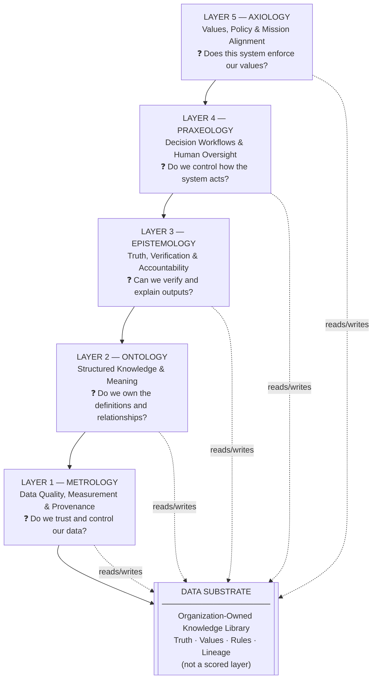

# Philosophical AI Architecture

*For enterprise and public sector leaders who approve AI investments*

The **Philosophical AI Architecture** is a draft decision frame for executives, business-unit owners, and the architects who carry out their decisions. It tells an organization what it must own in an AI system, and what it can rent, before a vendor or a technical team picks the tools. It is not a production system.

Using it changes intake. A proposal is scored on five questions and returned as **GO**, **CONDITIONAL GO**, or **NO-GO**, with the evidence and the gaps written down. **Predictive** work (pattern detection, forecasts, and scores) is recorded separately from **generative** work (summaries, explanations, and recommendations). Both have to cite owned evidence, and consequential actions keep a human checkpoint.

The five questions keep their names. Each name is a leadership responsibility:

- **Metrology** — measurement and telemetry. Do we trust the data?
- **Ontology** — shared definitions. Do we own what our terms mean?
- **Epistemology** — verification. Can we show why a score or a written answer is justified?
- **Praxeology** — action. Who approves what the system does?
- **Axiology** — value and priority constraints. Which rules can a prompt not switch off?

> **Own the brain. Rent the muscles.** Own the data, the definitions, the verification rules, the workflows, and the policy constraints. Rent compute and commercial models when those owned layers stay under organizational control.

Technical stack detail lives in [ARCHITECTURE.md](ARCHITECTURE.md) for architects and builders.

> **Business first.** MOEPA names what the organization must own. Tool choices come second. Writing rules for every page are in [pitch strategy](docs/pitch-strategy.md) §0, including the readability standard.

---

## Naming

Never conflate the overarching system with the operational tool.

| Term | What it is | Where to find it |
|---|---|---|
| **Philosophical AI Architecture** | The full ecosystem: Data Substrate, guardrails, own-vs-rent strategy, cognitive control plane | This README, [pitch strategy](docs/pitch-strategy.md), [glossary](docs/glossary.md) |
| **MOEPA 5-Layer Framework** | The engineering blueprint and governance engine inside the architecture: five layers, intake scoring, GO / CONDITIONAL GO / NO-GO | [5-Layer Framework for Leaders](docs/MOEPA-5-Layer-Framework.md), [Evaluation Checklist](docs/5-Layer-Evaluation-Checklist.md) |
| **MOEPA Cognitive Architecture** | The technical stack specification: storage mapping, tools, implementation playbook | [ARCHITECTURE.md](ARCHITECTURE.md) |

See [docs/pitch-strategy.md](docs/pitch-strategy.md) for audience-specific pitching guidance (enterprise leaders, public sector executives, and technical teams).

---

## The Core Mindset

**The blind spot:** Vendors sell demos. Technical teams often drive procurement. The reasoning behind a score or a recommendation then sits inside a platform the organization cannot audit.

**The response:** Map three cognitive functions into software the organization can govern:

| Function | Role | MOEPA layers |
|---|---|---|
| **Cognition** (knowing) | Define and verify reality | Metrology, Ontology, Epistemology |
| **Affect** (valuing) | Encode what matters and what is forbidden | Axiology |
| **Conation** (acting) | Execute decisions under human oversight | Praxeology |

- **Philosophy**, here, means the rules for what counts as real and what counts as verified (Metrology, Ontology, Epistemology).
- **Psychology**, here, means what the organization values and how it acts (Axiology, Praxeology).

**The mission:** Keep an audit record the organization owns. Rent commodity compute. Own the truth, the values, and the rules.

---

## Who This Is For

- **Enterprise executives and CXOs** — evaluating AI investment proposals and vendor dependency risk
- **Public sector leaders** (federal, state, local) — cognitive control plane for mission-critical accountability
- **Technical architects and engineers** — engineering blueprint for the Intelligence layer
- **Policy and compliance officers** — accountability, auditability, data sovereignty
- **Regulated industries** (healthcare, finance, critical infrastructure) — where decisions must be explainable to auditors and stakeholders

---

## The MOEPA 5-Layer Framework at a Glance

The five layers are the engineering blueprint inside the Philosophical AI Architecture. Each layer answers a distinct question a leader must be able to defend.



| Layer | Philosophical discipline | Business outcome leaders must own | Core leadership question |
|---|---|---|---|
| **Metrology** | Measurement | Trusted, auditable data foundation | Do we control and trust the data? |
| **Ontology** | Structure of reality | Shared definitions and relationships | Do we own the meaning of our domain? |
| **Epistemology** | Knowledge and truth | Verifiable conclusions with evidence | Can we explain and defend every output? |
| **Praxeology** | Purposeful action | Governed workflows with human oversight | Do we control how the system acts? |
| **Axiology** | Values and ethics | Mission alignment and enforced constraints | Does this system enforce our values? |

*For engineering translation (graphs, workflows, guardrails, storage), see [MOEPA 5-Layer Framework](docs/MOEPA-5-Layer-Framework.md) and [ARCHITECTURE.md](ARCHITECTURE.md).*

**The Data Substrate** is the organization-owned knowledge library — truth, values, rules, and lineage in one place that all five layers read from and write to. Intake uses that library, plus the five-layer score, to show what the institution already owns and what a new project must add. See [Data Substrate Concept](docs/Data-Substrate-Concept.md) for the business design; technical end-state detail is in [ARCHITECTURE.md](ARCHITECTURE.md) §5.

---

## Own vs. Rent: The Strategic Choice

| What to **Own** (permanently) | What to **Rent** (commodity) |
|---|---|
| Data Substrate — truth, values, rules, lineage | Raw compute and GPU capacity |
| Knowledge graphs and entity definitions (Ontology) | Commercial LLM API access |
| Verification standards and audit trails (Epistemology) | Cloud storage infrastructure |
| Decision workflows and oversight gates (Praxeology) | SaaS tooling with clear exit paths |
| Guardrails and compliance policies (Axiology) | Pre-trained model weights |

> **Core takeaway:** Own the Data Substrate (the organization's knowledge library: truth, values, rules, and lineage in one place). Rent model access when verification stays in house. A proposal that cannot be mapped to all five layers does not pass intake.

---

## Practical Use Cases

These scenarios are for any organization that must defend an AI decision to a customer, an auditor, or a regulator. Scores and match confidence are predictive. Explanations and denial reasons are generative. In each case the organization needs both the number and the record behind it.

**Enterprise and commercial:**
- **Loan and credit underwriting** — Can you explain a risk score to a customer or compliance reviewer?
- **AI project intake scoring** — Does every proposal map to all five layers, with evidence?
- **Customer service automation** — Can an agent audit exactly why the AI escalated or denied a request?
- **Fraud and risk detection** — Are scores based on your data and definitions, or the vendor's?

**Public sector and regulated programs:**
- **Third-party income verification** (benefits and compliance programs) — Can your system explain a confidence score of 98% to a constituent or auditor?
- **Benefits eligibility determination** — Can a caseworker audit exactly why the AI recommended denial?
- **Procurement and oversight review** — Can leadership produce a complete decision record without vendor mediation?

Detailed walkthroughs: [examples/](examples/)

---

## How to Use This Repository

**Leaders and executives (start here):**
1. [Pitch Strategy](docs/pitch-strategy.md) — business-first narrative and audience rules
2. [Business Leader Guide](docs/moepa-business-leaders-guide.md) — ownership and intake for any organization *(start here for enterprise)*
3. [Public Sector Leader Guide](docs/moepa-public-sector-leaders-guide.md) — accountability framing for government and public institutions *(federal, state, local)*
4. [MOEPA 5-Layer Framework for Leaders](docs/MOEPA-5-Layer-Framework.md) — one business question per layer
5. [5-Layer Evaluation Checklist](docs/5-Layer-Evaluation-Checklist.md) — GO / CONDITIONAL GO / NO-GO scoring
6. [Own vs. Rented AI Strategy](docs/Owned-vs-Rented-AI-Strategy.md) — what to own vs. rent
7. [Examples](examples/) — scenario walkthroughs (public-sector scenarios; principles apply broadly)

**Technical architects / engineers (after the business case is clear):**
1. [ARCHITECTURE.md](ARCHITECTURE.md) — MOEPA Cognitive Architecture technical spec
2. [Architectural Governance and Evolution Guidelines](docs/MOEPA-Architectural-Governance-and-Evolution-Guidelines.md) — implementation evolution rules
3. [Data Substrate Concept](docs/Data-Substrate-Concept.md) — knowledge library design

**Presenting the architecture:**
- [Pitch Strategy](docs/pitch-strategy.md) — audience hooks, terminology, tone rules

---

## Repository Structure

```
README.md                          ← Start here
ARCHITECTURE.md                    ← MOEPA Cognitive Architecture (technical spec)
│
├── docs/
│   ├── pitch-strategy.md                  ← Canonical pitch directive
│   ├── MOEPA-5-Layer-Framework.md         ← Business questions per layer
│   ├── Data-Substrate-Concept.md          ← Organization-owned knowledge library
│   ├── Owned-vs-Rented-AI-Strategy.md     ← Own substrate, rent compute
│   ├── 5-Layer-Evaluation-Checklist.md    ← Intake scoring rubric
│   ├── MOEPA-Architectural-Governance-and-Evolution-Guidelines.md ← MCP-first evolution rules
│   ├── moepa-business-leaders-guide.md    ← Executive handout (all organizations)
│   ├── moepa-public-sector-leaders-guide.md ← Public sector companion (federal, state, local)
│   ├── business-value.md                  ← Investment case
│   ├── faq.md                             ← Common questions
│   ├── glossary.md                        ← Term definitions
│   └── layer-diagram.md                   ← Stack diagram
│
├── diagrams/                              ← Architecture diagrams
└── examples/                              ← Scenario walkthroughs (public-sector scenarios)
```

---

## Key Documents

| Document | Audience | Purpose |
|---|---|---|
| [Pitch Strategy](docs/pitch-strategy.md) | All communicators | Business-first narrative, audience rules, terminology |
| [Business Leader Guide](docs/moepa-business-leaders-guide.md) | Executives (all organizations) | Business outcomes per MOEPA layer |
| [Public Sector Leader Guide](docs/moepa-public-sector-leaders-guide.md) | Government executives | Cognitive control plane, oversight accountability |
| [5-Layer Framework for Leaders](docs/MOEPA-5-Layer-Framework.md) | Leaders | One business question per layer |
| [Architectural Governance and Evolution Guidelines](docs/MOEPA-Architectural-Governance-and-Evolution-Guidelines.md) | Architects + contributors | Implementation evolution rules (not executive-facing) |
| [Evaluation Checklist](docs/5-Layer-Evaluation-Checklist.md) | Program managers | Intake scoring GO / CONDITIONAL / NO-GO |
| [Own vs. Rent Strategy](docs/Owned-vs-Rented-AI-Strategy.md) | CXOs, procurement | Own substrate, rent LLMs and compute |
| [Data Substrate Concept](docs/Data-Substrate-Concept.md) | Architects | Organization-owned knowledge library |
| [Glossary](docs/glossary.md) | All readers | Philosophical AI Architecture term hierarchy |
| [MOEPA Cognitive Architecture Spec](ARCHITECTURE.md) | Architects / CTO | Technical stack and implementation playbook |

---

## Feedback and Contributions

Open-source reference for the Philosophical AI Architecture. Feedback welcome via **issues only** — the maintainer implements accepted changes on `main`.

- **Suggest improvements:** open a [Feedback issue](https://github.com/PhilipAsiala/philosophical-ai-architecture/issues/new?template=feedback.yml) or [Proposal / RFC](https://github.com/PhilipAsiala/philosophical-ai-architecture/issues/new?template=proposal-rfc.yml) — do not open pull requests
- **Adapt for your organization:** MIT-licensed — fork and modify freely for your own use
- **Contribution policy:** [CONTRIBUTING.md](CONTRIBUTING.md)

> Theory and documentation only. No production code or working agents.

---

*Philosophical AI Architecture · MOEPA 5-Layer Framework v2.3 · June 2026 · MIT License*